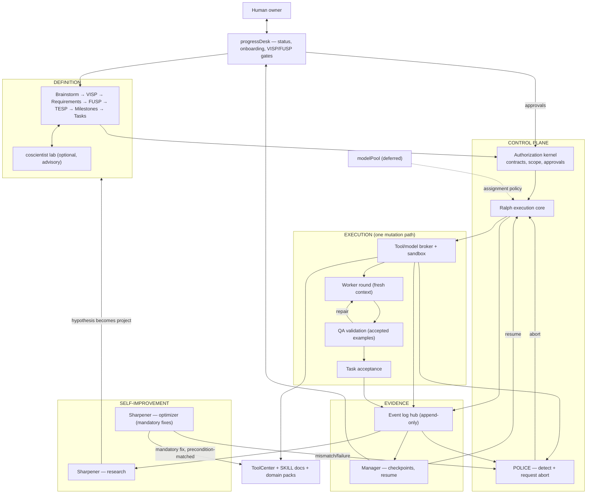

# VISP — Vision and Planning Specification

- Version: 1.0
- Status: NORMATIVE (per DESIGN_CONVENTIONS.md, v1.x = settled vision)
- Supersedes: all drafts (v0.1 and brainstorm material)
- Scope of authority: binding for all projects and modules in the workshop. Changes to this document require a new VISP version with human acceptance.

---

## 1. Vision statement

The workshop is a self-improving production environment for AI-assisted software and media output. Humans own vision, functional intent, and every release-relevant decision. Models assist with definition, exploration, implementation, and review; no model grants itself scope or declares its own success.

Stable products on top; a living substrate underneath. Products may sit; the substrate improves — but only through its own documented process, and only when evidence justifies the change.

## 2. Core doctrine

1. **One way of making things.** Every creation implements an existing task and passes one hardened loop (Ralph-inspired): lean build → validate against accepted examples → abort quickly on deviation → restart cheaply from a checkpoint. No side channels.
2. **Fail often, break early, iterate fast.** Aborts are cheap and expected. Each abort is a recorded learning point — never waste, never disgrace.  We are NOT afraid to make mistakes. We have git versioning to save us. Any abort is a chance to improve the critical path.
3. **Everything is a traceable event.** Work, aborts, lessons, costs, and the exact versions of every tool, skill, and model append to one event history. Restarting = replay of recorded state. History is dataset, audit trail, and fuel.
4. **Mandatory propagation of proven fixes.** When Sharpener has a problem, a solution, and a tested outcome, adoption is mechanical and mandatory for all in-scope projects — not re-gated per project. (Sole exception to rule 2's loop: such fixes enter directly as specified changes, with preconditions; any mismatch or failure causes an abort, which feeds back into learning.)
5. **Human authority at the contract level.** Every normative specification (VISP, FUSP) is human-approved before execution regardless of author — human, planning LLM, or Sharpener. Execution inside an approved contract needs no further approval.
6. **Oversight is structural, not supervisory.** The harness prevents messes structurally (authorization, allowlisting, sandboxing); POLICE covers the remaining open degrees of freedom by aborting. Nobody watches shoulders.
7. **Zero cash, honestly.** Only free models are employed. Absent verified free capacity, work pauses as `blocked_capacity` — never silently paid, never faked as success.

## 3. Definitions

- **VISP** — Vision and Planning Specification (this class of document). Normative.
- **FUSP** — Functional Specification. Normative; defines what a module must do.
- **TESP** — Technical Execution Specification. Normative; defines how, incl. model assignment policy per milestone.
- **Task** — smallest executable unit derived from a milestone; always inside an approved contract chain.
- **Abort** — termination issued only by POLICE. Always an event; always classified (security violation, ordinary defect, infrastructure failure, requirement conflict); always evaluated so handling matures over time.
- **Checkpoint** — named, immutable manifest (journal position, artifacts, versions, pending actions) from which a project can resume. Restarting = replay from checkpoint.
- **Accepted example** — human-accepted output used as validation evidence inside the loop.
- **Event** — immutable, schema-versioned record: id, type, producer, cause, timestamp, payload reference.

## 4. Module overview (M list)

Ordered by layer. One-line mandate each; details belong to FUSP/TESP.

Definition layer
- M1 **Definition pipeline** — Brainstorm → VISP → Requirements → FUSP → TESP → Milestones → Tasks/Gates. Optional coscientist inserted wherever structured uncertainty exists.
- M2 **Coscientist lab (addon)** — optional, advisory exploration unit: generates, debates, ranks solution paths. A phase, never a gate; never holds decision authority.

Control plane
- M3 **Authorization kernel** — enforces contract validity, scope, and human approvals synchronously before dispatch. Small, human-installed, trusted.
- M4 **Ralph execution core (workflow controller)** — runs the loop: dispatch worker, validate, abort/route, checkpoint.
- M5 **POLICE** — observes out-of-harness behavior; its only power is requesting aborts. Classifies each abort. Prevention is mostly structural; POLICE covers the rest.

Resource plane
- M6 **modelPool (acknowledged, deferred)** — governs free-only model assignment: static capability manifest + dynamic ledger of observed cost/quality/compliance. Details in later TESP. Never an executor's choice; assignment is a config attribute, switches are events.

Execution layer
- M7 **Tool/model broker + sandbox** — workers and QA run against versioned, sandbox-verified capabilities; no ambient credentials.
- M8 **Worker rounds** — fresh-context implementation bounded by the task packet.
- M9 **QA instruments** — independent validation against accepted examples and acceptance conditions. Worker claims never establish acceptance.

Evidence layer
- M10 **Event log hub** — append-only history of everything.
- M11 **Manager** — consolidates work history into named checkpoints; keeps every project resumable; produces views but holds no authority.

Human interface
- M12 **progressDesk** — status overview, project onboarding, and the mandatory human acceptance gate for every VISP and FUSP.

Self-improvement plane
- M13 **Sharpener, research mode** — scouts external tech and internal event history; forms confidence-scored impact hypotheses ("searches with interest"). Findings become a project or nothing.
- M14 **Sharpener, optimizer mode** — mechanically propagates verified lessons/fixes/tool versions to all affected projects whose preconditions match; mandatory adoption. Failures → abort.
- M15 **SKILL docs** — versioned agent instructions; updated when recurring aborts/deviations point at instruction quality.
- M16 **ToolCenter** — publishes versioned, sandbox-verified tools.

Domain packs
- M17 **Domain packs** — software and media share the core loop; domain-specific evaluators, examples, and rights checks live in packs referenced by TESP. The core never pretends one acceptance model fits all domains.

## 5. Human acceptance gates and POLICE

- **Gate rule.** ANY VISP and ANY FUSP requires human acceptance through progressDesk — including anything authored by Sharpener. TESP follows FUSP authority; material amendments re-gate.
- **POLICE.** Guards the harness by observation; enforces the gates as a detector (the kernel blocks synchronously). Its single power: abort.
- **Deviation handling.** An executor "thinking out of the box" is either aborted (triggering human involvement) or harvested later by Sharpener as a method/tool. Recurring aborts modify the responsible skill/tool/model assignment. No special mechanism; this follows from the model.

## 6. Resource doctrine (modelPool, summarized)

- Model = harness-configured attribute; assignment is governed, never chosen by executors.
- Ranking combines cost/quality/compliance measured on own workloads; compliance = instruction-following-under-harness (POLICE stats). Own-workload evidence outweighs public leaderboards.
- Ledger-based budget envelope per project; breach = event, not silent bleed.
- Threat noted, implementation deferred: model switching after repeated aborts can mask defective tools, bad requirements, or evaluator failures. Mitigation: classify cause before substitution. No further design in V1.
- Scope: acknowledged in Vision only; full mechanics in a later TESP.

## 7. System diagram (normative layout)

## 8. Scope

Explicit (in)
- All modules M1–M17 at the level defined above.
- Event-driven history with replay/checkpoint semantics.
- Human-gated normative specs; abort-driven learning; mandatory optimizer propagation.

Implicit (follows from the model — nothing to implement specifically)
- Deviation remediation via abort→harvest→instruction update.
- Compliance ranking feeding model assignment once modelPool exists.

Acknowledged but deferred
- modelPool ranking/employment mechanics; behavior-vs-anticipated interface; task taxonomy seeding.
- Sharpener graduation to any form of auto-insertion.
- Coscientist lab internals beyond the advisory/phase-not-gate rule.

Out of scope for v1.0
- Multi-user/team operation; paid model fallback; rendered-image or non-text review channels.

## 9. Open threads (parked, non-blocking)

- Event schema versioning policy.
- Restart granularity (per-task vs per-milestone).
- Checkpoint manifest exact contents.
- Spec object field schemas per pipeline stage (to be fixed in FUSP/TESP).
- Sharpener confidence scoring method for impact hypotheses.
- Breadth/limits of optimizer precondition matching.

## 10. Acceptance of this VISP

This document becomes normative upon recorded human acceptance in progressDesk. Prior drafts are void. Any future change = new version, new gate.
