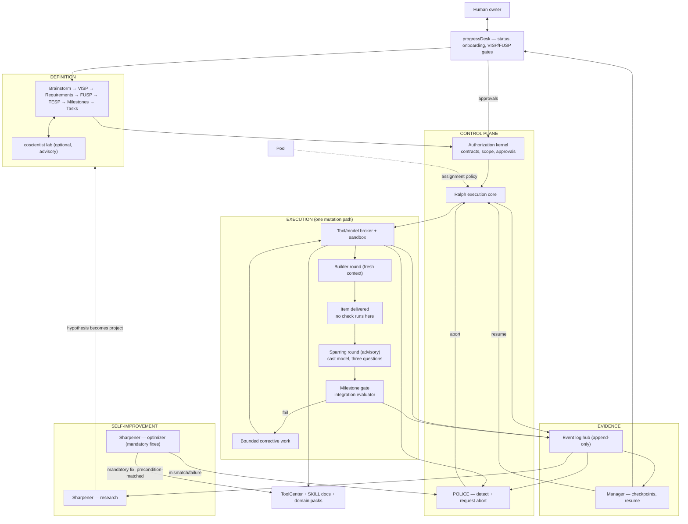

# VISP — Vision and Planning Specification

- Version: 1.11
- Status: NORMATIVE — owner-directed v1.8 amendment; acceptance record pending
- Supersedes: v1.9
- Amendment note (1.9 → 1.11): §1A gains one clause on Sharpener's feedback edge, referencing FUSP F-S8. Aligned to FUSP v1.11; the two move together. Sub-decimal: architecture unchanged, no new actor, no new gate.
- Scope of authority: binding for all projects and modules in the workshop. Changes to this document require a new VISP version with human acceptance.

---

## 1. Vision statement


The workshop is a self-improving production environment for AI-assisted software and media output. Humans own vision, functional intent, and every release-relevant decision. Models assist with definition, exploration, implementation, and review; no model grants itself scope or declares its own success.

Build for success, expect to fail. The build is planned so that failure is repeatable but not expected: the normal path is the leanest and thinnest, because it is walked the most; the exception path may involve more work, but must not therefore be complex.

Stable products on top; a living substrate underneath. Products may sit; the substrate improves — but only through its own documented process, and only when evidence justifies the change.

Our thesis is that human weight belongs at the front — ideation, acceptance, steering — and nowhere else. That is a claim about where judgement is spent, and it is tested by whether the owner is still steering. If it is not, the thesis is wrong and the system is misbuilt.

Whether that holds is established between milestones, by whoever receives the deliverable. Not here, and not continuously.

The framework is a self-improving, self-steering production environment, and its own improvement is a product of itself: Sharpener observes, proposes and pushes VISPs, so the system gets better without being told how to get better. Below a point, no human is needed.

Human weight belongs at the front, where it is worth the most. A concept is massaged with an LLM into a milestone plan; the human signs the VISP; the human sees the FUSP and may steer; the TESP then happens largely without human input.

```text
concept --(human + LLM)--> milestone plan --> VISP --human signoff-->
FUSP --human sees, may steer--> TESP --largely autonomous--> build
```

The human is the most expensive input in the system, so they are spent once, deliberately, on vision. Everything below that line must be self-sufficient. The one permanent exception is steering, which stays available at all times and without negotiation — an unconditional stop-everything control. Being stopped or overridden is not a failure of the system; it is the guarantee that the human is still sovereign.

Three properties follow as acceptance criteria for the backbone rather than aspirations: it is **reliable**, it is **fast**, and it always assigns the **cheapest model that can actually do the task** — and the best one whenever the cheap one cannot.

## 1A. GOSPEL BUILDER LOOP (NORMATIVE ARCHITECTURE)

There is no supervisor role. The deterministic loop runner/gateway dispatches
work and applies recorded results; it does not investigate failures, split
tasks, perform judgment-heavy cleanup, or decide success.

`process_next_round(item)` is the single lifecycle operation:

1. `0` is ordinary todo. Dispatch the builder with the task and minimal claim
   context, and set the item to `NUL` for the unresolved attempt.
2. A successful builder completion sets the item to `1` and invokes SHARPENER.
   SHARPENER may update lessons files without creating a VISP, distribute a
   lesson or builder instruction within the approved contract, or trigger the
   next iteration. If it deems a framework modification necessary, it MUST
   create a VISP and push it into normal human review and signoff. A run that
   submits no rationale invokes SHARPENER on this same path: a contract not
   honoured is a framework finding, not a governance breach, and the correction
   lands on the instruction that produced the silence (FUSP F-S8).
3. SHARPENER has two operating roles:
   - **Observer:** may act during processing. It notices problems or possible
     framework changes, updates lessons files without a VISP, and MUST create a
     VISP for a framework modification it deems necessary. An urgent framework fix may
     therefore be proposed during processing, before build completion.
   - **Researcher:** may act after the project build is complete. It may also be
     triggered directly by the user through progressDesk before completion. It
     may update lessons files without a VISP; if it finds a valuable
     decision-bearing change, it MUST create a VISP for human review.
   After the last builder completion, the normal loop may automatically enter
   a separate framework-improvement round conducted by SHARPENER. The same
   SHARPENER function is always directly triggerable from progressDesk; direct
   invocation does not depend on the automatic completion route.
4. A builder failure, timeout, or disappearance invokes HOUSEKEEPING. It
   discards the prior session's scratch/debris while preserving the event
   history as evidence and checks restartability. If the scene is dirty,
   SCHOTTY may clean it; if a real governance violation is found, POLICE
   handles it. Then `process_next_round(item)` runs again.
5. If the item is `NUL` when `process_next_round` runs, JACK_THE_SPLITTER may
   split it into two independently deliverable children. The first child is
   dispatched as `NUL`; the other remains ordinary todo (`0`). If JACK cannot
   split, it towels. `NUL` is a lifecycle state, not a child exit code.

The event history records who acted; no separate `lastWorker` checklist field
is implied. Ownership of these transitions is layered, and the layering is
normative rather than incidental:

- **Authorization is the kernel's.** `kernel.authorize` decides whether a round
  may begin at all, against role, action, parent currency, signoff, GO and
  declared scope. No other layer may admit a round.
- **Process ownership is the broker's, exclusively.** The loop layer is a
  *caller* of the broker, never a spawner, and holds no path around it. The
  mechanism is TESP §7.1. This corrects v1.6, which named `builderctl`/the loop
  boundary "the deterministic runtime owner" — in practice a layer that could
  spawn outside the job, contradicting TESP §7.1.
- **The deterministic ctl layer keeps the authoring plane and the operations
  with no equivalent elsewhere.** `authorctl` remains the authoring-plane
  interface. `builderctl` keeps the deterministic lifecycle operations the
  kernel and broker do not provide: `housekeeping`, `split-apply`,
  `police-apply`, `drain-intents`, and the journal/status operations. Those are
  reusable convenience, not a governance surface.
- **Checkpoint and progress state is reached, never owned.** No layer holds it
  directly. The builder asks an API what the state is and proposes its writes
  through that same API; the gateway records and validates them rather than
  refusing them, and what bypasses the gateway is caught afterwards rather than
  prevented. Verification is a separate act by someone other than the builder:
  deterministic checks wherever they can settle it, a QA role for the judgement
  surfaces they cannot. Self-certification is therefore structurally absent, and
  a scene that goes wrong is recoverable. The API is TESP; the separation is
  doctrine.
Net effect: the deterministic/judgment split above becomes enforceable rather
than merely described. The constraint moves from "the loop must not spawn" to
"the loop cannot spawn".

**Parked design notes:** Housekeeping is currently deterministic. An
LLM-assisted Housekeeping role, provisionally called JEF or Laya, may be
studied later. JACK may need more technical-design context than the minimal
claim bundle on the exception path; that is a known limitation of this
success-shaped design, not a reason to add a second failure classifier. Whether
a JACK towel is first sent to SHARPENER for a bounded retry/skill decision
remains an open owner decision; the terminal default is red light.

This VISP amendment describes the architecture only. FUSP/TESP and the
ProgressDesk implementation plans are not amended by this change; they remain
for the later product-planning pass.

## 1B. OPTIMAL BACKBONE (VISION)

The backbone is one deterministic core. It gives each role a clear, explicitly stated context to work in — and it does not assume that context will be honoured. §1A says which roles exist; this says what they must stand on. These are properties, not designs: the TESP decides how.

- **Scoped context, assumed fallibility, no preventive coding.** A builder is
  given a clear context in which to work, and the design states that context. It
  is equally stated that the agent may not honour it — we do not pretend
  otherwise. What we do not do is code for that: no mechanism exists to prevent a
  rogue write, and none is added speculatively. What we build instead is rubble
  handling. The write is seen after the fact, HOUSEKEEPING clears what clears
  mechanically, SCHOTTY forensically restores what does not, and the escalation
  terminates rather than loops. Prevention is not the goal; a recoverable scene
  is.
- **One process-ownership path.** Exactly one named authority may end a project process, and the human's own processes sit outside its reach by construction. The loop does not spawn; it asks.
- **One evidence store.** Status, tripwire, gates, recovery and cost all derive from it. Prose is never authoritative state, and nothing is retained for human retrospection — the store exists for the exception path and for attribution.
- **Two planes: one free, one opaque.** The builder works freely on the project it is building — no gating, no approving, no asking; anything that slows the build down is a defect. What it does not get is the governance plane: no checklist, no state machine, no view of how it is judged. It reaches that only by calling the API, and it does not conclude anything about its own acceptance — governance meaning is settled by a deterministic check or a QA role. The split is over what it may see and conclude, not over what it may build.
- **Environment is not failure.** Missing tooling, encoding noise and wrong-directory are an infra-fault class: typed, surfaced, stopping. Never budget-consuming, never recorded as bad work, never silently retried.
- **A sparring round after creation.** The builder reports complete and its work is not inspected. Then a *different* model, cast from free capacity, spends one short round on three fixed questions: has this drifted from the task, were the right choices made, were the principles kept. It is advisory and never blocks — the item is finished either way. The verdict is recorded because it feeds the milestone gate and Sharpener, not because it gates anything.
- **Every execution is attributed.** What ran, on which model, at what cost, and how it verified. Attribution is the sensor, and it is the precondition for the cheapest-best assignment in §1: without it, Sharpener has nothing to react to and assignment stays a guess frozen at design time.
- **Cheap to start, cheap to discard.** Operators and workers begin with nothing, do one bounded thing, and are replaced without ceremony. A role that must be nursed is a role that was handed too much.
- **It launches.** A backbone that cannot be started is a library, and composition is not a finishing touch — it is the last milestone that matters.

## 1C. COMPOSITION: TWO HALVES OF ONE LOOP (VISION)

The backbone is not one of its two ancestors. The normal path and the exception path come from different stock, and it needs both.

The **normal path** is the substrate: authorization in the kernel, containment in the broker, a bounded round, an independent QA verdict, and one evidence store that everything else derives from. It is heavily tested and lightly initiated.

The **exception path** is the cast: HOUSEKEEPING as the deterministic first responder, SCHOTTY forensically restoring what mechanical cleanup cannot, JACK_THE_SPLITTER decomposing a stuck item instead of grinding it, and POLICE as the single authority for ending a process. It is the newer half, and it is where the doctrine actually lives.

They compose as two chains, both terminal, never looping:

```text
non-delivery  -> JACK            -> two deliverable halves -> converge | towel -> red light
crash         -> HOUSEKEEPING    -> restartable? resume : SCHOTTY -> cleaned? | towel -> red light
                 (POLICE only for a real governance violation)
```

Frequency buys the right to be expensive. HOUSEKEEPING runs at every boot and after every child exit, so it is deterministic and cheap; JACK and SCHOTTY are expensive and rare, which is exactly what makes them affordable. The red light is a state plus a stop record, not a process — and it is pull-only, so a human can always see it.

Both halves speak through the one gateway and the one store. Merging the two lineages must not produce two systems of record.

## 1D. MODEL PERFORMANCE, COMPETITIONS AND THE SCOUT

The framework must be able to answer, on evidence rather than opinion: **for a given kind of task, which model is cheapest and best?** That question is answered by the framework measuring itself, not by preference.

Three commitments follow.

1. **Attribution is not optional.** Every execution records who acted, on what, with which model, and at what cost. A system that cannot attribute cannot compare, and a system that cannot compare cannot claim to be improving.
2. **Competitions.** The system's own codebase and its own history are the corpus. Tasks are drawn from real slices we have already solved, at known risk, with known-good results to compare against. A competition runs the same slice on several models and the winner is recorded. Competitions are a measurement instrument, not a contest.
3. **ModelScout is Sharpener's, and is not yet built.** The researcher role already gathers results on completion. ModelScout is the part that turns those results into a per-task-class ranking, notices where the cheap model is now good enough, and notices where it is not. It proposes; it never applies. It is the mechanism by which the vision "always assign the cheapest model that can actually do the task" stops being a slogan.

The cost-reduction-versus-urgency setting and model routing are operational and are not specified here. What is stated here is the obligation to measure.

## 2. Core doctrine

1. **One way of making things.** Every creation implements an existing task and passes one hardened loop (Ralph-inspired): lean build → validate against accepted examples → abort quickly on deviation → restart cheaply from a checkpoint. No side channels.
2. **Fail often, break early, iterate fast.** Aborts are cheap and expected. Each abort is a recorded learning point — never waste, never disgrace.  We are NOT afraid to make mistakes. We have git versioning to save us. Any abort is a chance to improve the critical path.
3. **Everything is a traceable event.** Work, aborts, lessons, costs, and the exact versions of every tool, skill, and model append to one event history. Restarting = replay of recorded state. History is dataset, audit trail, and fuel.
4. **Mandatory propagation of proven fixes.** When Sharpener has a problem, a solution, and a tested outcome, adoption is mechanical and mandatory for all in-scope projects — not re-gated per project. (Sole exception to rule 2's loop: such fixes enter directly as specified changes, with preconditions; any mismatch or failure causes an abort, which feeds back into learning.)
5. **Human authority at the contract level.** Every normative specification (VISP, FUSP) is human-approved before execution regardless of author — human, planning LLM, or Sharpener. Execution inside an approved contract needs no further approval.
6. **Oversight is structural, not a separate supervisory role.** The harness prevents messes structurally (authorization, allowlisting, sandboxing); POLICE covers the remaining open degrees of freedom by aborting. The deterministic runner/gateway only dispatches and applies recorded results. Nobody watches shoulders.
7. **Zero cash, honestly.** Only free models are employed. Absent verified free capacity, work pauses as `blocked_capacity` — never silently paid, never faked as success.
8. **Local-first, and cheap on tokens.** Mainly local LLM machines, so token burn is a budget, not a preference. Prefer the deterministic step over a model that would re-derive it, and the smallest model that meets the acceptance bar. When work blocks or a decision is needed, report to the owner immediately rather than spending tokens to reach an already-visible conclusion. Attribution is what makes this measurable — see §1B.

## 3. Definitions

- **VISP** — Vision and Planning Specification (this class of document). Normative.
- **FUSP** — Functional Specification. Normative; defines what a module must do.
- **TESP** — Technical Execution Specification. Normative; defines how, incl. model assignment policy per milestone.
- **Task** — smallest executable unit derived from a milestone; always inside an approved contract chain.
- **Abort** — termination issued only by POLICE. Always an event; always classified (security violation, ordinary defect, infrastructure failure, requirement conflict); always evaluated so handling matures over time.
- **Checkpoint** — named, immutable manifest (journal position, artifacts, versions, pending actions) from which a project can resume. Restarting = replay from checkpoint.
- **Accepted example** — human-accepted output used as validation evidence inside the loop.
- **Event** — immutable, schema-versioned record: id, type, producer, cause, timestamp, payload reference.

## 4. Module overview (M list)

Ordered by layer. One-line mandate each; details belong to FUSP/TESP.

Definition layer
- M1 **Definition pipeline** — Brainstorm → VISP → Requirements → FUSP → TESP → Milestones → Tasks/Gates. Optional coscientist inserted wherever structured uncertainty exists.
- M2 **Coscientist lab (addon)** — optional, advisory exploration unit: generates, debates, ranks solution paths. A phase, never a gate; never holds decision authority.

Control plane
- M3 **Authorization kernel** — enforces contract validity, scope, and human approvals synchronously before dispatch. Small, human-installed, trusted.
- M4 **Ralph execution core (workflow controller)** — runs `process_next_round`: dispatch a builder with minimal context, apply completion/failure transitions, and route recovery/Sharpener branches.
- M5 **POLICE** — observes out-of-harness behavior; its only power is requesting aborts. Classifies each abort. Prevention is mostly structural; POLICE covers the rest.

Resource plane
   It is the one role that is **never** placed in a container: it holds the process
   handles it needs in order to stop a run, and a containment boundary around it
   would disarm the only authority able to stop anything. Its safety comes from
   fixed narrow authority — it can stop, classify and record, and nothing else — and
   from typed input only, never raw transcripts. An attacker who talks POLICE into a
   false stop has cost us time, not authority.

Execution layer
- M7 **Tool/model broker + sandbox** — workers and QA run against versioned, sandbox-verified capabilities.
- M8 **Worker rounds** — fresh-context implementation bounded by the task packet. A *worker* is any active entity in the workshop; a *builder* is the worker that builds checklist features.
- M9 **QA instruments** — independent validation against accepted examples and acceptance conditions. Worker claims never establish acceptance.

Evidence layer
- M10 **Event log hub** — append-only history of everything.
- M11 **Manager** — consolidates work history into named checkpoints; keeps every project resumable; produces views but holds no authority.

Human interface
- M12 **progressDesk** — status overview, project onboarding, and the mandatory human acceptance gate for every VISP and FUSP.

Self-improvement plane
- M13 **Sharpener** — has an observer role during processing and a researcher role after build completion (or when directly triggered by the user through progressDesk). It may update lessons files without a VISP. If it deems a framework modification necessary, or identifies a valuable decision-bearing change, it MUST create a VISP and push it into the human review/signoff pipeline. After the last builder completion, the normal loop may enter a framework-improvement round conducted by SHARPENER.
- M14 **Sharpener, optimizer mode** — mechanically propagates verified lessons/fixes/tool versions to all affected projects whose preconditions match; mandatory adoption. Failures → abort.
- M15 **SKILL docs** — versioned agent instructions; updated when recurring aborts/deviations point at instruction quality.
- M16 **ToolCenter** — publishes versioned, sandbox-verified tools.

Domain packs
- M17 **Domain packs** — software and media share the core loop; domain-specific evaluators, examples, and rights checks live in packs referenced by TESP. The core never pretends one acceptance model fits all domains.

## 5. Human acceptance gates and POLICE

- **Gate rule.** ANY VISP and ANY FUSP requires human acceptance through progressDesk — including anything authored by Sharpener. TESP follows FUSP authority; material amendments re-gate.
- **POLICE.** Guards the harness by observation; enforces the gates as a detector (the kernel blocks synchronously). Its single power: abort.
- **Deviation handling.** An executor "thinking out of the box" is either aborted (triggering human involvement) or harvested later by Sharpener as a method/tool. Recurring aborts modify the responsible skill/tool/model assignment. No special mechanism; this follows from the model.


## 7. System diagram (normative layout)



## 7A. Builder-loop overlay

The target control diagram above is overlaid by this lifecycle:

```text
0 item -> builder(task + minimal context) -> NUL
NUL + successful completion -> 1 -> SHARPENER
NUL + failure/timeout/disappearance -> HOUSEKEEPING
       -> optional SCHOTTY
       -> optional POLICE for a real violation
       -> process_next_round
NUL at process_next_round -> JACK -> first child NUL + second child 0

Reaching the red light is the last rung, not the first. Between a stalled attempt
and the red light sit **cheap machine rungs** — re-decompose the task, narrow the
scope, re-run with a different strategy — each bounded and each cheaper than the
one before. The ladder terminates; it does not loop.
during processing -> SHARPENER observer -> lessons (no VISP)
                                      -> deems framework modification necessary -> urgent VISP
last builder completion -> SHARPENER researcher/framework round
                              -> lessons/no change
                              -> valuable change -> VISP for human review
user via progressDesk -> SHARPENER researcher (direct, any time)
```

This is the exception-and-learning path; it is not a separate supervisory
watcher and it does not replace human signoff for normative VISPs.

## 8. Scope

Explicit (in)
- All modules M1–M17 at the level defined above.
- Event-driven history with replay/checkpoint semantics.
- Human-gated normative specs; abort-driven learning; mandatory optimizer propagation.

Implicit (follows from the model — nothing to implement specifically)
- Deviation remediation via abort→harvest→instruction update.

Acknowledged but deferred
- Sharpener graduation to any form of auto-insertion.
- Coscientist lab internals beyond the advisory/phase-not-gate rule.

Out of scope for v1.0
- Multi-user/team operation; paid model fallback; rendered-image or non-text review channels.

## 9. Open threads (parked, non-blocking)

- Event schema versioning policy.
- Restart granularity (per-task vs per-milestone).
- Checkpoint manifest exact contents.
- Spec object field schemas per pipeline stage (to be fixed in FUSP/TESP).
- Sharpener confidence scoring method for impact hypotheses.
- Breadth/limits of optimizer precondition matching.
- JEF/Laya: whether deterministic Housekeeping should gain LLM intelligence.
- Whether a JACK towel should receive a bounded SHARPENER review before the terminal red light.
- Whether JACK needs additional technical-design context on the exception path.
- Exact progressDesk surface and authorization for direct invocation of the SHARPENER researcher/framework-improvement function.
- The QA role is not yet specified. It is architecturally load-bearing — it is what makes acceptance non-self-certified — and currently under-defined: what it may read, what it may assert, what it is allowed to reject, how its independence from the builder is guaranteed, and what it costs. Blocking for any milestone that cannot be settled by a deterministic check.

## 10. Acceptance of this VISP

This document is the owner-directed v1.8 amendment. v1.0 through v1.7 remain preserved as history. Any future change = new version, new gate.

- **ModelScout and the competition harness** — parked, unimplemented. Owned by the researcher role. Blocked on attribution, not on the ranking logic.
- **Baseline run and target table** — no target is set until one completed phase has been replayed and measured. A target without a baseline is a wish.
- **Cost-reduction versus urgency** — an owner-side routing setting, outside the framework. Not specified here.
